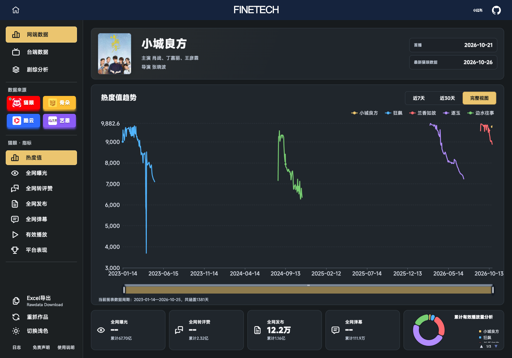

# 聚势 · FINETECH 前端

**非营利剧集与综艺信息查询工具的前端源码。**

聚势希望减少查询作品表现时反复切换网站、手动整理数据的操作，让剧集和综艺的热度、播放与收视表现更方便地查看和分析。

[在线使用](https://glintscore.com/) · [本地预览](#本地预览) · [API 接入约定](docs/API.md) · [参与贡献](CONTRIBUTING.md) · [MIT License](LICENSE)



*截图展示在线产品界面，图中数值为截屏时的来源快照。本地演示使用合成数据。*

## 项目定位

聚势以非营利方式维护，在线工具免费提供使用。本仓库采用 MIT 许可公开前端代码，便于学习界面、交互、图表和数据导出实现。

**当前开源范围仅包含前端。** 生产 API、来源采集器、服务端核验实现、统计数据库、管理员认证和服务器配置不在本仓库的发布范围内。前端中的 API 调用与状态协调代码用于连接服务，不包含来源采集器实现。

## 功能

- 剧集、综艺搜索与作品信息展示。
- 热度、曝光、互动、播放及收视等指标的看板呈现。
- 主作品之外最多添加四部作品进行同期分析。
- 按日期查看趋势，切换近 7 天、近 30 天和完整视图。
- 按视频平台或播出频道切换适用指标。
- Excel 导出、来源说明、深浅主题和多端布局。

真实查询需要兼容的后端服务。仅克隆本仓库不会获得在线站点的采集服务或生产访问权限；本地演示不向第三方数据源发起请求。

## 数据来源与数据处理

在线产品按需读取第三方公开页面提供的作品信息和指标，不将第三方作品采集明细写入自建业务数据库作长期留存，也不维护用于积累这些明细的影视历史数据仓库。

查询期间的数据用于看板展示、任务运行及用户主动导出。浏览器会按标签页临时保存看板状态；服务运行存在短期任务结果、榜单及海报缓存。网站访问统计独立处理，统计记录与作品采集明细是不同用途的数据，具体以在线站点的隐私说明为准。

| 来源 | 在线产品的主要用途 |
| --- | --- |
| [猫眼专业版](https://piaofang.maoyan.com/) | 热度、曝光、转评赞、发布、弹幕、有效播放、平台表现、台端收视 |
| [骨朵数据](https://d2.guduomedia.com/) | 剧集、综艺榜单热度及排名 |
| [酷云](https://www.ky.live/pc.html) | 剧集全端热度、增长指数 |
| 艺恩 | 当前显示“开发中”，停用采集 |

聚势不生产来源平台的原始指标。不同来源的热度、播放量和收视率有不同口径，不能直接等同或简单相加；具体定义和历史修订以来源平台的原始页面为准。

源端缺失、未发布、读取失败和未核验分别处理，数值 0 不代表缺失。来源断点不补零，也不靠跨缺口连线生成连续走势。当日指标持续变化时，展示和导出对应查询获得的快照。

公开页面可访问不等于获得任意再使用授权。使用本项目时应遵守来源平台规则，合理控制访问频率；访问受限时应停止，不绕过登录、付费或访问限制。项目的非营利定位与来源说明不构成法律免责保证。

## 本地预览

需要 Node.js 22.13 或更高版本和 npm。前端预览不需要安装采集器或系统 Chrome。

```bash
git clone https://github.com/ILIKEPIZZAAA/FINETECH-jushi-tv-popularity-search-engine.git
cd FINETECH-jushi-tv-popularity-search-engine
npm ci
npm run dev
```

打开 <http://127.0.0.1:5173/> 可查看首页。默认不连接生产后端，搜索和采集会提示需要配置后端。

查看合成数据看板：

```bash
npm run demo
```

也可打开 <http://127.0.0.1:5173/__dashboard-demo.html>；综艺示例使用 `/__dashboard-demo.html?type=variety`。演示记录明确标为合成数据，只用于布局、图表、主题和 Excel 导出预览，不代表任何作品的真实表现。演示入口只在开发服务器可用，不进入生产构建。

连接你自己维护的兼容 API 时，复制 `.env.example` 为 `.env.local` 并设置 `VITE_API_PROXY_TARGET`。不要默认把开源副本代理到在线站点，也不要在前端环境变量中放入私钥、Token 或管理员密码。接口约定见 [docs/API.md](docs/API.md)。

## 目录

```text
src/           React 页面、图表、状态管理、API 客户端和导出 Worker
public/        静态资源与来源说明图解
test/          前端单元测试和开发用合成数据示例
docs/          API 接入约定和界面示意
vite.config.js 开发预览、可选 API 代理与生产构建
```

```bash
npm test
npm run build
npm run preview
```

`npm run preview` 仅预览构建后的静态前端，不会启动采集器、生产 API 或演示数据入口。

## 反馈

欢迎通过 [Issues](https://github.com/ILIKEPIZZAAA/FINETECH-jushi-tv-popularity-search-engine/issues) 反馈界面和交互问题。请注明浏览器、屏幕尺寸、复现步骤和预期行为；涉及在线数据的问题请说明作品、来源、指标和日期。截图请去除个人信息，不要公开提交访问凭据或个人访问记录。

## 许可与第三方内容

前端代码采用 [MIT License](LICENSE)，允许使用、修改与再分发，需保留版权与许可声明。项目的非营利维护定位不对 MIT 的代码使用权限增加额外限制。

影视海报、平台标识、第三方页面和来源数据的权益归相应权利人所有，不随前端代码获得再授权。仓库中的界面示意图用于说明项目功能，其他使用请核对相应来源和授权条件。
